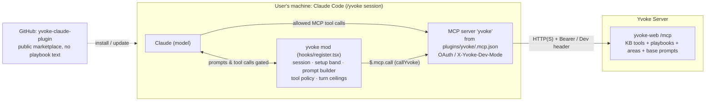

# System Architecture

How the Yvoke plugin and in-process mod work inside Claude Code today. Product principles live in [product.md](product.md), living feature specifications live in [../specs/index.md](../specs/index.md), and planned extensions live in [../../PLAN.md](../../PLAN.md). Decisions and their reasons live in [decisions.md](decisions.md).

## 1. Runtime Split



| Component | Location | Responsibility |
| --- | --- | --- |
| **Marketplace repo** | `.claude-plugin/marketplace.json` | Self-hosted public marketplace (`yvoke`). Never stores playbook text, secrets, or customer data. |
| **Plugin `yvoke`** | `plugins/yvoke/.claude-plugin/plugin.json` | Installable unit (`yvoke@yvoke`). Declares `userConfig` settings (`serverUrl`, `devMode`, `showPrototypes`, `turnLimitSingle`, `turnLimitLead`, `turnLimitAgent`) and `PluginState` types. |
| **MCP server `yvoke`** | `plugins/yvoke/.mcp.json` | Connects Claude Code to `yvoke-web` (`/mcp`). Sends `X-Yvoke-Dev-Mode` in local mock mode and leaves `Authorization` unset so OAuth sign-in can run when configured. Both model tool calls and the mod's `$.mcp.call` share this connection, so the mod never handles tokens. |
| **In-process mod** | `plugins/yvoke/hooks/register.tsx` | Registers Claude Code hooks for `/yvoke` session activation (`session.ts`), setup band (`setup.ts`), system prompt composition (`system-prompt.ts`), tool gating (`policy.ts`), and turn ceilings (`turn-limits.ts`). Active only after `/yvoke`. |
| **`yvoke-web`** | Spring AI MCP server (`/mcp`) | Source of truth for base instructions (`get_system_prompt`), areas (`list_areas`), playbooks (`list_playbooks`, `get_playbook`), and knowledge-base retrieval tools. |

## 2. Hook Pipeline & Question Lifecycle

The hooks currently wired in `plugins/yvoke/hooks/register.tsx` register in this exact order (first registered = outermost):

1. `registerSetup(on, options)` (`plugins/yvoke/src/setup.ts`)
2. `registerSession(on)` (`plugins/yvoke/src/session.ts`)
3. `registerPolicy(on)` (`plugins/yvoke/src/policy.ts`)
4. `registerTurnLimits(on, options)` (`plugins/yvoke/src/turn-limits.ts`)
5. `registerSystemPrompt(on)` (`plugins/yvoke/src/system-prompt.ts`)

```text
Claude Code engine (Desktop Code tab / terminal)
 ├─ MCP server 'yvoke' (.mcp.json) → search_corpus, get_section, verify_citations, …
 └─ mod (plugins/yvoke/hooks/register.tsx), active only in a /yvoke session:
     ├─ session.start        registers the /yvoke slash command
     ├─ command.run          setup.ts runs outermost, calls next(e) so session.ts activates the Yvoke session, then loads areas & playbooks
     ├─ classic.SessionStart clears on /clear; restores Yvoke flag & setup on /resume and /branch (fork)
     ├─ session.end          records the ending session ID under $.store key 'ended' for /branch inheritance
     ├─ ui.render            renders AbovePrompt setup band (Selects when unlocked, read-only line when locked; the error and Retry when the lists failed, under the locked line too); Retry's onPress loads the lists again
     ├─ prompt.submit        setup.ts loads missing or failed lists (for a locked setup too, with the D-20 version upgrade) and wraps system-prompt.ts, which loads instructions from yvoke-web; setup.ts locks only if not dropped
     ├─ prompt.compose       appends session section `yvoke:instructions` (base + `\n\n---\n\n` + playbook)
     ├─ tool.call            single gate in src/policy.ts: the mod's own Yvoke server calls pass, then the turn limit check, then playbook tool policy
     ├─ turn.step            tracks request index per loop; strips tool uses at request ceiling `n`
     └─ turn.complete        appends turn-limit notice line beneath main-loop answers that hit request `n`
```

### Question Flow Today

1. **Opt-in (`/yvoke`):** In any session without `/yvoke`, every hook immediately calls `next(e)`. When the user runs `/yvoke` before the first question, `registerSetup`'s outer `command.run` hook calls `await next(e)`, which runs `registerSession`'s inner `command.run` hook to persist `{ yvoke: true }` in `$.store` (`session:<id>`) and set `yvokeSession: true` in `$.state`; `setup.ts` then loads `list_areas` and `list_playbooks`.
2. **Setup Selection (`AbovePrompt`):** The band offers **Area** (default `OIM`), **Mode** (*Single agent*; *Multi-agent* is gated behind `MULTI_AGENT_READY = false` in `setup.ts`), and **Playbook** (`name vN`, default `area.defaultPlaybook`).
3. **First Question & Lock (`prompt.submit` + `prompt.compose`):** `registerSetup`'s outer `prompt.submit` hook ensures the catalogue and setup are ready and calls `next(e)`, which runs `registerSystemPrompt`'s inner `prompt.submit` hook to load base instructions (`get_system_prompt`) and the chosen playbook (`get_playbook`), joined by `\n\n---\n\n`. If any server call fails, `system-prompt.ts` drops the question with a `Yvoke Backend:` error and `setup.ts` leaves the setup unlocked. Once `next(e)` returns without dropping the question, `setup.ts` sets `lockedSessionId` and updates `$.ui.status`.
4. **Tool Gate & Turn Ceilings (`tool.call` + `turn.step` + `turn.complete`):** Every model tool call passes through the single `tool.call` gate in `src/policy.ts`. The mod's own `$.mcp.call` reaches it too, as a call with this plugin as origin, and the gate lets those to the Yvoke server through first. Request `n - 1` denies tool calls with a wrap-up directive; below the limit, only `ToolSearch`, `AskUserQuestion`, and the Yvoke server tools granted by the active playbook (`allowedServerTools`) are permitted. The server's `ask_clarifying_question` asks nobody over MCP, so when the playbook grants it the gate catches the call, asks the user with `$.ui.ask`, and answers the model itself; the server never sees it. This also works in subagents, which Claude Code gives no `AskUserQuestion`. Request `n` strips remaining tool calls in `turn.step` and adds a footer line in `turn.complete`.

### Planned Architecture Extensions

Planned capabilities tracked in [`PLAN.md`](../../PLAN.md) extend this pipeline without altering existing module boundaries:
- **Playbook Preflight (`src/preflight.ts`):** Registers a `prompt.submit` hook (with matcher `{ text: /^/ }`) **before** `registerSetup` in `hooks/register.tsx` so any user-approved playbook switch updates `yvoke.setup` before `registerSetup` locks the session and `registerSystemPrompt` loads instructions.
- **Tool Policy Extensions (`src/policy.ts`):** Enforces domain-restricted `WebSearch`/`WebFetch` when enabled in `userConfig` and declared by the playbook, and gates mod-registered `execute_code` running under Claude Code's `Bash` sandbox.
- **Citations (`src/citations.ts`):** Parses UUID and legacy citation markers in `AssistantMessage` (`ui.render`) and opens a source passage `Pane` via `get_section`.
- **Multi-Agent Investigations:** Flips `MULTI_AGENT_READY = true`, loads profiles (`list_profiles`, `get_profile`), registers specialists and the reviewer via `$.agent.register`, enforces specialist spawn budgets in `agent.spawn`, and runs enforced citation review rounds via `submit_answer` and `submit_review`.

## 3. Module Boundaries & State Storage

- **One module per feature (`plugins/yvoke/src/`):** Pure decision/parsing functions (no `$` parameter) live at the top of each module so they can be unit-tested directly, followed by `register<Feature>(on, options)` wired in `plugins/yvoke/hooks/register.tsx`.
- **Session state (`$.state`):** Declared in `plugins/yvoke/types/index.d.ts` under `PluginState.yvoke` (`yvokeSession`, `setup`, `catalogue`, `instructions`, `loopStep`). Survives hot reload within a session, cleared on `/clear`.
- **Persistent store (`$.store`):** 4 MiB JSON store shared across sessions on the machine. Used for session/setup restoration across `/resume` and `/branch` (`session:<id>`, `setup:<id>`, `ended`). `/yvoke` deletes the `session:` and `setup:` entries of sessions beyond the newest 5,000 (D-28).

## 4. Platform Constraints

- **Claude Code `>= 2.1.287`:** Minimum version supporting mods; verified in CI against both `2.1.287` and `latest`.
- **Minimal API footprint:** The mod never calls `$.fs`, `$.process`, or `$.http` (enforced by `.lintel/scripts/build.sh` via `claude plugin validate --strict plugins/yvoke`).
- **Folder trust & managed organizations:** Mods load only after the user trusts the working folder. In organizations with managed Claude Code settings, the plugin must be installed via managed settings or an MDM directory marketplace so `prompt.compose` and `classic.SessionStart` hooks are not skipped.
